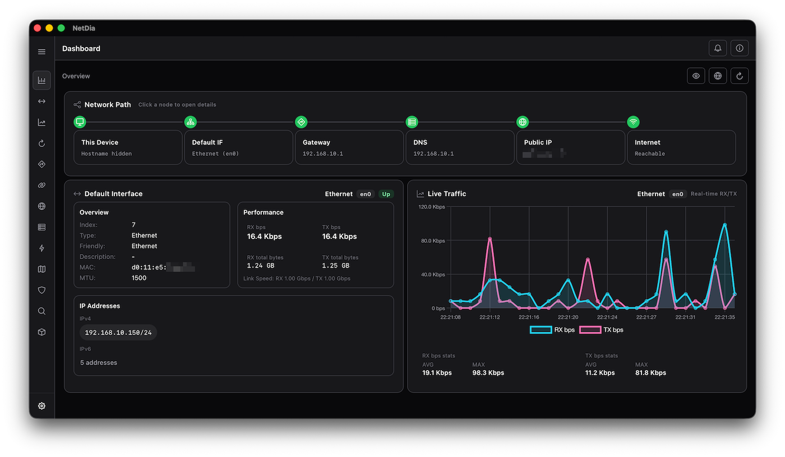
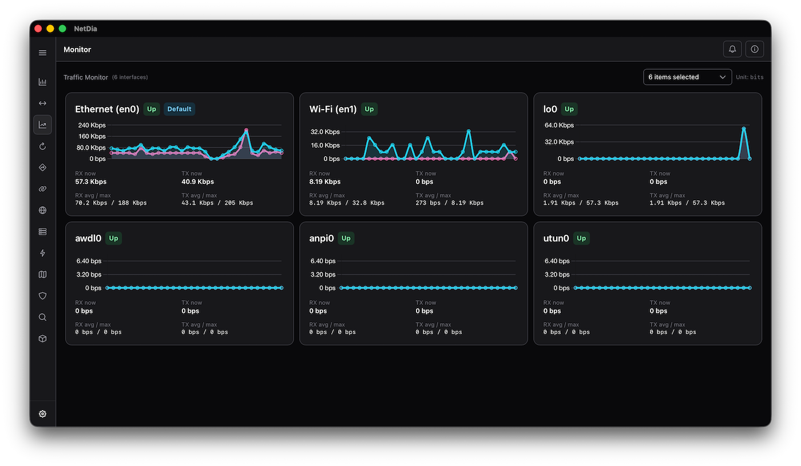
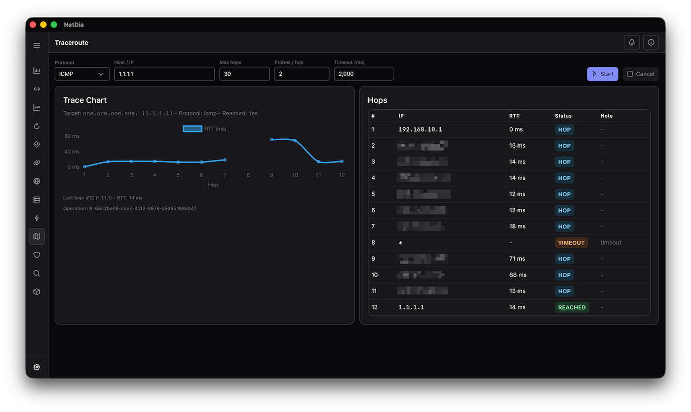
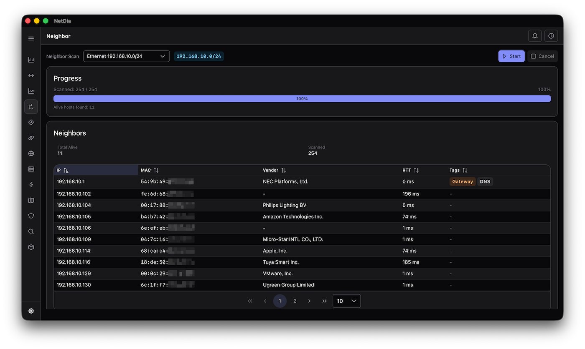

# NetDia

NetDia is a desktop network diagnostic tool for macOS, Windows, and Linux,
built with Rust and Tauri.




## Features

- Network interfaces, routing tables, neighbors, and socket connections
- Live traffic charts and download/upload speed tests
- Public IP, ASN, and country information
- DNS lookups, ping, and traceroute
- Host discovery, port scanning, and service detection

## Install

- **macOS:** Download the DMG from [Releases](https://github.com/shellrow/netdia/releases)
  and drag NetDia into Applications.
- **Windows:** Install from the [Microsoft Store](https://apps.microsoft.com/detail/9NLQ03PT1DXQ).
  Updates are managed by the Store.
- **Linux:** Download an AppImage, deb, or rpm from [Releases](https://github.com/shellrow/netdia/releases).
  In-app updates are available for AppImage installations.

macOS installations also support in-app updates.

AppImage GPG signing-key fingerprint:

```text
3BA76883CE83EC30C03B1399261B16ACBF7FF010
```

## Build from source

Install a current stable Rust toolchain, Node.js 22 LTS (22.12 or later), and the
[Tauri system prerequisites](https://v2.tauri.app/start/prerequisites/) for your OS.

Clone the repository and install frontend dependencies. These steps are required
for both CLI options below.

```sh
git clone https://github.com/shellrow/netdia.git
cd netdia
npm ci
```

The npm CLI is installed by `npm ci`. To use `cargo tauri`, install the
[Rust CLI](https://v2.tauri.app/reference/cli/):

```sh
cargo install tauri-cli --version "^2" --locked
```

Run either CLI from the repository root:

| Action | npm | cargo tauri |
| --- | --- | --- |
| Run in development mode | `npm run tauri -- dev` | `cargo tauri dev` |
| Build an application bundle | `npm run tauri -- build` | `cargo tauri build` |

Both options use npm to start or build the frontend automatically.

## Screenshots




